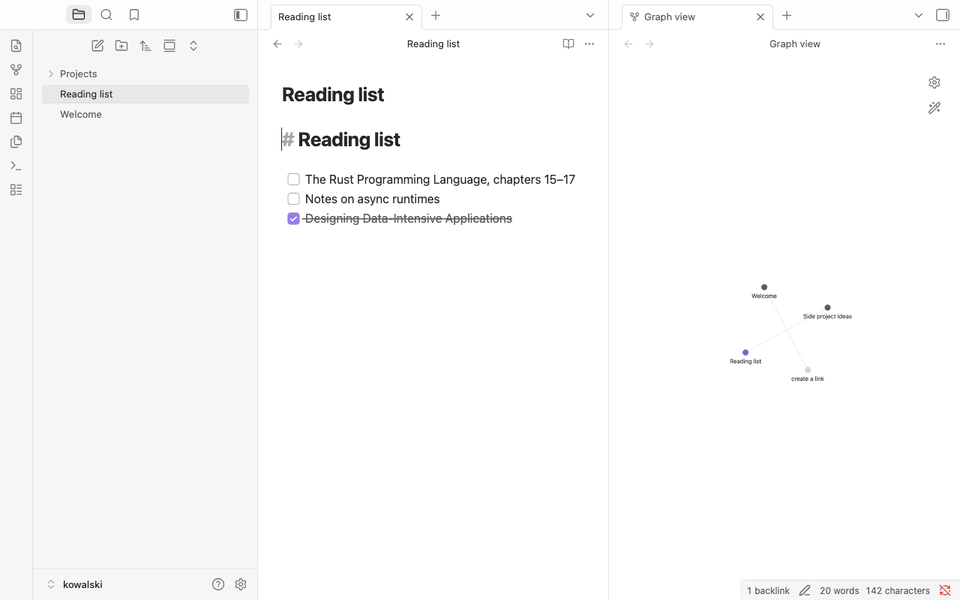

# Kowalski

> "Kowalski, analysis!"

**You already have a local model. Kowalski gives it jobs.** A horde is a pipeline of small steps:
ordinary code does the fetching, the SQL and the file writing, and the model only writes a query
or a paragraph, so a 2B model on a laptop CPU finishes real chores. Kowalski is one binary: point
it at Ollama (or any OpenAI-compatible endpoint with your key) and give a horde your
pages, notes and documents. The answers come back as files you can open: a morning brief, a note
in your vault, a note with deadlines.



*A question to the Knowledge Compiler, and the note it writes arriving in an Obsidian vault.*

**Current release: 2.6 — Field Notes.** What changed and when: [CHANGELOG.md](CHANGELOG.md) ·
what is next: [ROADMAP.md](ROADMAP.md).

**Tried it?** [Tell me what you ran and where it broke](https://github.com/yarenty/kowalski/discussions/146).
One line is enough; there is no telemetry, so this is the only way I find out.

<a href="https://alternativeto.net/software/kowalski/about/?utm_source=badge&utm_medium=referral"></a>

---

## Install

**Mac:** download [**Kowalski.dmg**](https://github.com/yarenty/kowalski/releases/latest/download/Kowalski.dmg),
open it, drag **Kowalski** to Applications and open it. It starts kowalski and opens your
browser; quit it from the Dock to stop. Apple Silicon and Intel, signed and notarized.

**Mac, with Homebrew:**

```bash
brew install yarenty/tap/kowalski
kowalski
```

**Mac or Linux, from a terminal:**

```bash
curl -fsSL https://raw.githubusercontent.com/yarenty/kowalski/main/install.sh | bash
kowalski
```

macOS and Linux, Intel or ARM. The installer downloads the pre-built `kowalski` and `kowalski-cli`
from the latest release into `~/.local/bin`, checks their checksum and adds that folder to your
shell's PATH for new terminals (it prints the full path to use right away); no Rust needed.
`kowalski` opens the app in your browser, where Setup asks for:

1. **A model** — Ollama if it is running (its models are listed), or an OpenAI-compatible endpoint
   and key. A Check button tests it without spending tokens.
2. **A files folder** — the only place the agents' file tools may read and write.
3. **A notes vault and web search** (optional) — where finished notes are saved, and how agents search.

Setup writes the config to `~/.config/kowalski/config.toml` and restarts the server. Everything
kowalski keeps (the config, built-in hordes and their output, run history, memory) lives in that
folder, whichever folder you start it from. The archives are also on the
[releases page](https://github.com/yarenty/kowalski/releases).

<details>
<summary>Installer options</summary>

| Variable | Effect |
|----------|--------|
| `KOWALSKI_BIN_DIR=~/.local/bin` | Where the binaries go |
| `KOWALSKI_RELEASE=v2.6.1` | A specific release instead of the latest |
| `KOWALSKI_FROM_SOURCE=1` | Build from crates.io with cargo instead (no UI inside) |
| `KOWALSKI_VERSION=2.6.1` | crates.io version (source build) |
| `KOWALSKI_FEATURES=postgres` | `cargo install --features postgres` (source build) |
| `KOWALSKI_INSTALL_MCP=1` | Also install `kowalski-mcp-rookery` (source build) |
| `KOWALSKI_NO_MODIFY_PATH=1` | Leave your shell profile alone (download mode) |
| `KOWALSKI_SKIP_RUSTUP=1` | Fail instead of auto-installing Rust (source build) |

</details>

---

## What a horde does for you

Hordes ship inside the binary and appear in the Hordes screen on first start. Among them:

| Horde | You give it | You get |
|---|---|---|
| **Morning brief** | The pages you check every morning | `BRIEF.md`: a top pick and the items worth your time from each page, with links. A weekday 7:00 schedule is ready to switch on. |
| **Folder watcher** | Documents dropped into its `inbox/` | `NOTE.md`: what the document is, the key facts, and what to do by when. |
| **URL summarizer** | A list of links | A short summary per page. |
| **Knowledge compiler** | Articles, repos, notes | A compiled knowledge pack you can ask questions of. |

Scheduled and watching hordes ship switched off: nothing runs, or costs, until you turn it on.
Steps that would run a command or write into a project stop and ask for your approval first;
**Always allow** remembers it for a step you trust, until the step changes or you revoke it in Setup.

## Is Kowalski for you?

| You want… | Kowalski | Better elsewhere |
|---|---|---|
| Something useful to do with the model you already run in Ollama | ✓ | |
| Answers from your own pages and documents, as files you open | ✓ | |
| To run on a laptop with a free local model, nothing leaving the machine | ✓ | |
| One download, no Docker, no database server | ✓ (about 20 MB) | |
| A chat assistant with wide access to your machine and apps | | a personal assistant such as [OpenClaw](https://github.com/openclaw/openclaw) |
| To manage many paid coding agents as a team, with org charts and budgets | | an agent control plane such as [Paperclip](https://github.com/paperclipai/paperclip) |
| Hundreds of SaaS connectors and click-built workflows | | a workflow tool (n8n, Zapier) |

Penguins: no lobsters, no corporation.

## Make your own

A horde is a folder of Markdown: `horde.md` (the pipeline and its triggers), `agents/*.md` (one
file per step: what kind of step, what it reads, where it writes) and `prompts/`. Copy a built-in
one next to your config and change it, or describe what you want in the **Rookery** tab and let
the builder write the folder. Hordes can run on a schedule, when a file lands, or from a webhook,
and travel between machines as a single `.kwf.zip` bundle.

---

## How it works


One process holds the operator UI, the HTTP API, the horde runner and the agent core. Runs are
durable (every state change goes to SQLite, and runs survive restarts). Tools are a small built-in
set (`web_fetch`, `web_search`, files) plus anything that speaks MCP. Deterministic steps do the work models are bad
at — fetching, reading files, running SQL, writing notes — so a small local model only
has to write a query or a paragraph from material it has been given.

The full picture, with diagrams of one run and the run lifecycle:
**[docs/architecture.html](docs/architecture.html)**.

---

## Build from source

```bash
git clone https://github.com/yarenty/kowalski.git && cd kowalski
(cd ui && bun install && bun run build)      # the UI is compiled into the server
cargo build --release
./target/release/kowalski                    # http://127.0.0.1:3456, opens your browser
```

Rust stable and [Bun](https://bun.sh) for the UI; [Ollama](https://ollama.com) if you want a local
model. [`config.example.toml`](config.example.toml) documents every setting; your own
`config.toml` is git-ignored. Build with `--features postgres` for Postgres memory (pgvector) and
graph queries.

| Command | What it does |
|---|---|
| `kowalski` | Server with the UI (`--bind`, `--no-open`, `--auth`) |
| `kowalski-cli` / `kowalski-cli chat` | Terminal chat with your model and MCP tools |
| `kowalski-cli chat "hello"` | Ask once, print the answer, exit |
| `kowalski-cli agent-app export <horde>` / `import <bundle>` | Move a horde as one file |
| `kowalski-cli mcp ping` / `mcp tools` | Check the MCP servers in your config |
| `kowalski-cli doctor` | Environment check |

**UI development:** run `kowalski`, then `cd ui && bun run dev` (Vite on :5173 proxies `/api`).
See [`ui/README.md`](ui/README.md).

**Security defaults:** no token is needed on 127.0.0.1; bound to any other address the API
always requires the bearer token printed at first start. Imported hordes run their steps in a
separate process with triggers switched off.

### Rust API

```rust
use kowalski_core::agent::Agent;
use kowalski_core::config::Config;
use kowalski_core::template::TemplateAgent;

#[tokio::main]
async fn main() -> Result<(), Box<dyn std::error::Error>> {
    let config = Config::default();
    let model = config.ollama.model.clone();
    let mut agent = TemplateAgent::new(config).await?;
    let conv = agent.start_conversation(&model);
    let reply = agent.chat_with_history(&conv, "Hello", None).await?;
    println!("{reply}");
    Ok(())
}
```

### Workspace

| Crate | Role |
|---|---|
| [`kowalski`](kowalski/) | The server binary: HTTP API, horde runner, triggers, Setup, embedded UI and hordes |
| [`kowalski-core`](kowalski-core/) | Agents, model providers, tools, MCP client, memory, step handlers, bundles |
| [`kowalski-cli`](kowalski-cli/) | Terminal chat, bundles, MCP checks, isolated step runner |
| [`kowalski-mcp-rookery`](kowalski-mcp-rookery/) | The horde builder as an MCP server |
| [`ui/`](ui/) | Vue 3 operator UI |

### Ecosystem

| Project | What it is |
|---|---|
| [**emperor-mcp**](https://github.com/yarenty/emperor-mcp) | The MCP server framework first-party servers are built on (stateless HTTP, credential forwarding, output framing). |
| [**emperor-folder**](https://github.com/yarenty/emperor-folder), [**-pdf**](https://github.com/yarenty/emperor-pdf), [**-mail**](https://github.com/yarenty/emperor-mail), [**-vikunja**](https://github.com/yarenty/emperor-vikunja) | A folder, PDFs, mail and Vikunja tasks as MCP tools for agents; read-only unless started otherwise ([guide](docs/guide/10-files-pdf-mail-tasks.md)). |
| [**Paperclip**](https://github.com/paperclipai/paperclip) | Hire a horde as an employee in a Paperclip company: assign it an issue, the answers come back in the thread ([guide](docs/guide/09-paperclip.md)). |

New first-party MCP servers get their own repositories on `emperor-mcp`; this repository stays
the runtime.

---

## Documentation

- [kowalski.yarenty.com](https://kowalski.yarenty.com) — the blog
- [docs/guide/](docs/guide/README.md) — the user guide (also built into kowalski, so Chat can answer from it)
- [docs/architecture.html](docs/architecture.html) — how it is built
- [docs/](docs/README.md) — technical notes (`dev/`), articles (`blog/`), ideas (`concepts/`)
- [examples/](examples/) — every built-in horde, readable as plain files
- [CHANGELOG.md](CHANGELOG.md) · [ROADMAP.md](ROADMAP.md) · [AGENTS.md](AGENTS.md) for contributors and coding agents

## Contributing

> "Contributing is like dating – it's fun until someone suggests changes."

Issues and pull requests are welcome. Please add tests and update the docs that your change makes
wrong.

## License

MIT. See [LICENSE](LICENSE).

> "AI agents are like penguins – they look organised, but it's all improvisation."


