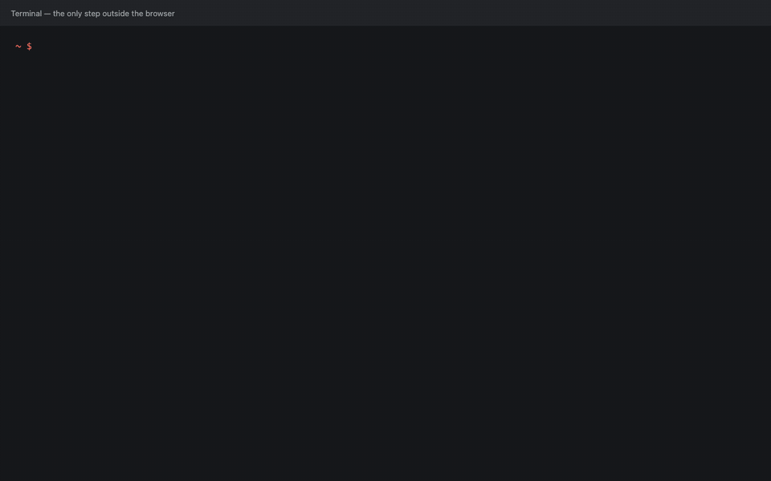

<!-- post: date=2026-10-25; slug=meet-kowalski; summary=Kowalski is a small team of AI agents that runs on your own computer: it answers questions about your spreadsheets, reads the pages you follow, files your research in your notes. What it does, how it got here in eighteen months, and how to try it. -->
# Meet Kowalski

*October 2026*

Welcome to the [Kowalski blog](https://kowalski.yarenty.com). This is the first post written for
people who have never heard of Kowalski, so let's start at the beginning.

**Kowalski is a small team of AI agents that lives on your own computer and does chores for
you.** Not a chatbot you have to keep talking to, and not a platform you have to administer. You
hand it a job, it does the job, and you get a file back. It's open source (MIT), written in Rust,
and it runs on a free local model through [Ollama](https://ollama.com), or on any hosted model
with your own key.

There are two well-known open-source projects in the same neighbourhood, and they help to
explain what Kowalski is by what it isn't. [OpenClaw](https://github.com/openclaw/openclaw) is a
personal assistant you chat with: it gets wide access to your machine and your apps, and it
works best with a big frontier model behind it. [Paperclip](https://github.com/paperclipai/paperclip)
goes one level up: it runs a whole "company" of paid coding agents, with org charts, budgets and
approvals. Both are impressive. Kowalski makes the opposite bet. Each job is a small, fixed
pipeline you can read. The agents only touch the one folder you give them, and they ask before
doing anything risky. The hard parts (fetching pages, running SQL, building spreadsheets) are
ordinary code, so a small free model on a laptop is enough. The result is cheaper (€0 a run on a
local model), more private (nothing leaves your machine), and easier to trust (every number
comes from a query, not from the model's imagination). Penguins: no lobsters, no corporation.

So what do you actually give it? A chore: a question about a spreadsheet, the five pages you read
every morning, a document that just landed in your inbox, a topic to research. Kowalski hands the
chore to a **horde**, a short pipeline of specialised agents we call penguins, and gives you back
something you can use: a report workbook, a one-page brief, a note in your Obsidian vault.



## What it does today

Five hordes come with it:

- **Spreadsheet analyst.** Ask questions about your workbooks in plain words and get a report
  workbook back. The model writes the SQL; every number comes from a query engine, never from
  the model.
- **Morning brief.** The pages you follow, read for you: the few items worth your time, why each
  matters to you, and the link. It can run every weekday at 7:00.
- **Folder watcher.** Drop a document into its inbox and get a note: what it is, the key facts,
  and what to do by when.
- **Knowledge compiler.** Ask a question and list the pages that should answer it. You get one
  note with its sources, saved straight into your Obsidian vault.
- **URL summarizer.** A list of links in, a short summary of each out.

A horde is a folder of plain Markdown files, so you can read exactly what each penguin is told,
copy one and change it, or have kowalski build a new one with you.

## How it got here

Kowalski started on 4 March 2025 as a weekend experiment: a Rust program that could talk to a
local Ollama model. Here's the short version of what happened next.

- **2025: big plans.** By the summer it had a five-layer architecture, a crate per agent, three
  databases and a federation layer for a distributed system nobody was running. It was a good
  exercise and a bad product: nothing in it could be handed to someone who doesn't write Rust.
- **Early 2026: smaller.** 1.0 deleted most of that on purpose. One agent type instead of many
  crates, SQLite instead of three databases, an HTTP server and a web UI, and tools reached
  through MCP.
- **Spring 2026: hordes.** The idea that gave the project its shape: a pipeline as a folder of
  Markdown. Builders, graphs with loops, then triggers (cron, file watch, webhook) and durable
  runs that survive a restart.
- **September 2026: the product.** One binary with the UI inside, a three-question Setup,
  ready-made hordes, and data steps that keep numbers out of the model. Since 2.5: a signed Mac
  app you install by dragging it to Applications.

Eighteen months and more than 700 commits later, the pattern is clear: almost every good change
removed something. The long version of that story is
[Eighteen months of Kowalski](architecture-history.md).

## Who it's for

People with recurring chores and data they'd rather keep on their own machine: a small business
owner with a sales workbook, an engineer who reads the same five sites every morning, a
researcher whose notes live in Obsidian. If you write code, a horde is a folder you can version,
review and share.

## Try it

On a Mac, download [Kowalski.dmg](https://github.com/yarenty/kowalski/releases/latest/download/Kowalski.dmg),
drag it to Applications and open it. On a Mac or Linux, from a terminal:

```bash
curl -fsSL https://raw.githubusercontent.com/yarenty/kowalski/main/install.sh | bash
kowalski
```

Your browser opens on Setup: pick a model, a folder, and optionally your tableski account. Then
pick a horde and send it in. Everything is at
[github.com/yarenty/kowalski](https://github.com/yarenty/kowalski).

If something goes wrong, [open an issue](https://github.com/yarenty/kowalski/issues). Kowalski
does the analysis; I do the apologising. And if everything works first time, just smile and
wave, boys. Smile and wave. 🐧
