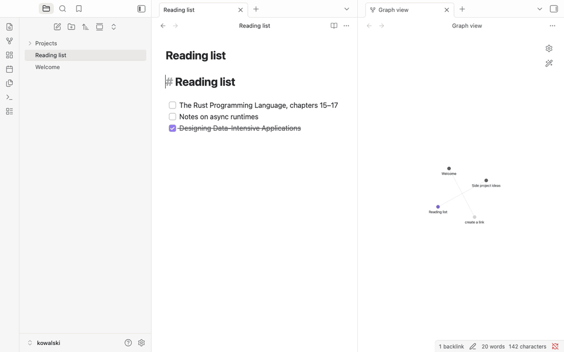

<!-- post: date=2026-10-25; slug=notes-in-your-vault; summary=Ask a question, give kowalski the pages that should answer it, and the Knowledge Compiler writes one note with its sources, straight into your Obsidian vault. A local model, no account, no copy-paste. -->
# Ask a question, find the answer in your vault

*October 2026*

Most research ends the same way: twelve tabs, a half-written note, and a promise to tidy it up
later. Kowalski's **Knowledge Compiler** does the tidy-up. You ask a question and list the pages
that should answer it. It reads them, compiles what they say, answers your question, and saves
the result as a note **in your Obsidian vault**, with its sources and tags, ready to link from
the rest of your notes.



## What it does

You fill in two lines:

- **What should the note answer?** For example, "What are the main ways to learn Rust?"
- **Pages or notes to read**: links, one per line. For the question above, the Rust project's
  own learning page is enough.

Four penguins do the work. The first fetches the pages and keeps their readable part. The second
compiles a digest of what they say. The third answers your question from that digest, and only
from it. The fourth turns the answer and the digest into one clean note, with a title, tags and
the sources linked.

## Straight into your vault

In kowalski's Setup, point **Notes vault** at your Obsidian vault, once. From then on every
finished note lands in its **Kowalski** folder, named by date and question:

```text
Kowalski/2026-10-01 What are the main ways to learn Rust.md
```

Obsidian sees it at once: it's just a Markdown file in the vault's folder, no plugin needed. The
note's front matter shows up as **Properties**, so it's searchable and filterable like the rest
of your vault:

```yaml
title: Rust Programming Language Overview
tags: [rust, programming, learning, documentation, systems]
source: kowalski
horde: knowledge-compiler
run: run-1790854216626-1
created: 2026-10-01
```

A note is never overwritten: ask again tomorrow and you get a second note next to the first.
The run page in kowalski says where the note went, with an **Open in Obsidian** link.

The Morning brief uses the same vault. Switch on its weekday 7:00 schedule and you get a dated
brief in the vault every morning.

## Local, all the way

The demo runs `gemma4:e2b` through Ollama on a laptop CPU: about five minutes for four penguins
and one page. The pages are public, the model is yours, and the note stays in your folder.
Nothing goes to a service you didn't choose. With a hosted model and your own key it's faster;
the note ends up in the same place.

## Try it

On a Mac, download [Kowalski.dmg](https://github.com/yarenty/kowalski/releases/latest/download/Kowalski.dmg),
drag it to Applications and open it. On a Mac or Linux, from a terminal:

```bash
curl -fsSL https://raw.githubusercontent.com/yarenty/kowalski/main/install.sh | bash
kowalski
```

In Setup, set **Notes vault** to your Obsidian vault's folder. Then open **Knowledge Compiler**
on the Hordes screen, ask your question, and list the pages that should answer it.
