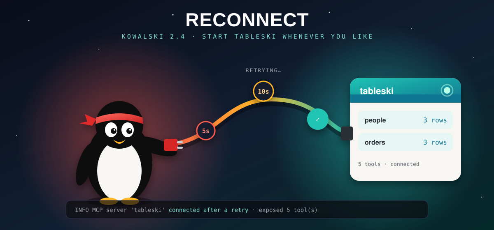
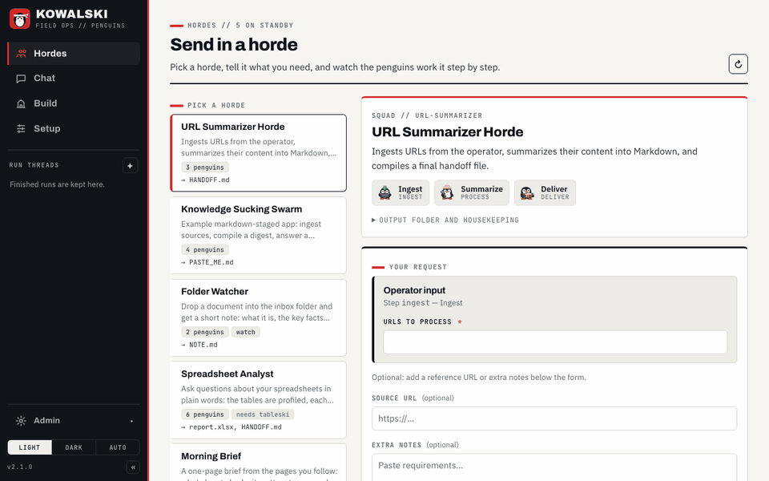

<!-- post: date=2026-10-25; slug=kowalski-2-5; summary=Kowalski 2.5 Double Click: a signed Mac app you download, drag to Applications and open, no terminal needed. And since 2.4 Reconnect, tableski and other MCP servers can start in any order. Now on crates.io. -->
# Kowalski 2.5: Double Click, and start things in any order

*October 2026*



Two releases went out at the end of September, and both came from the same exercise: recording a first run of
kowalski from scratch and fixing whatever got in the way. The recording now goes from download to
answers in one take, and on a Mac it no longer needs a terminal at all.

## Download, drag, open

Kowalski 2.5, *Double Click*, ships **Kowalski.dmg** with every release. Open it, drag
**Kowalski** to Applications and open it: it starts kowalski and opens your browser on Setup. It
runs on Apple Silicon and Intel, and it's signed with our Developer ID and notarized by Apple, so
macOS opens it without asking you to lower any security settings. Clicking the Dock icon opens
the browser again, and quitting the app stops kowalski.

[Download Kowalski.dmg](https://github.com/yarenty/kowalski/releases/latest/download/Kowalski.dmg)

Here's the whole first run, from the installer to the answers. The model's thinking time is sped
up, and the tableski sign-in itself isn't shown:


Recording it found three bugs a first-time user would have hit, and 2.4.1 and 2.4.2 fixed them.
Setup now restarts kowalski after you sign in to tableski, so the agents get its tools straight
away. Save creates the files folder Setup suggests, instead of refusing it because it doesn't
exist yet. And the Spreadsheet analyst shows each question's own result rows under its answers.

## Start things in any order

This part is 2.4, *Reconnect*. Our first take of the new demo failed before the model had said a
word: kowalski was already running when we started tableski, so the Spreadsheet analyst found no
tables until we restarted kowalski. Nobody should have to know the right order to start two
programs in.

Kowalski talks to its tools over MCP: tableski for spreadsheets, a gateway for the Docker
catalog, anything you add in `config.toml`. Until now it connected to them once, at start, and a
server that wasn't up yet was forgotten.

Now a server that doesn't answer is kept on a waiting list. Kowalski tries it again after 5
seconds, then 10, 20, and every minute after that, and stops as soon as it answers. It also tries
straight away when a run needs one of that server's tools, so a question you ask right after
starting tableski doesn't wait for the next tick. The log says so when it works:

```text
INFO  MCP server 'tableski' connected after a retry
INFO  MCP server 'tableski' exposed 5 tool(s)
```

## A local tableski, explained

The horde page has a **Workbooks** card for uploading files to tableski.io. With a tableski
running on your own machine it used to show an upload box and then a red error, because a local
tableski has no upload. Now the card says what is going on: your tableski serves the files it
was started with, and `tableski --file your.xlsx` is how you give it another one.

## Three fixes the camera found

- A horde with its own form no longer shows a stray "Follow-up question" field under it.
- A finished run no longer keeps a red "No progress arrived in 60 s" warning. The warning is for
  a run that never started, and it goes away at the first sign of life.
- Small models sometimes wrap their whole answer in a code block. Kowalski now saves the answer
  itself, so the Spreadsheet analyst's hand-off renders as answers instead of grey Markdown source.

With those fixed, the new recording runs from the Hordes home through ⌘K, two questions, a
follow-up on the same data and the Runs page in one take:



## For Rust users

The four crates are on crates.io as 2.5.0. Since 2.3, `kowalski-core`'s MCP types have changed: `McpHub::attach` registers the hub's tools with a `ToolManager` and keeps them
coming, `McpHub::bindings()` replaces `iter_bindings()`, and `ToolManager` can ask a refresher
for tools it doesn't have yet. The
[changelog](https://github.com/yarenty/kowalski/blob/main/CHANGELOG.md) has the details.

## Get it

On a Mac, [Kowalski.dmg](https://github.com/yarenty/kowalski/releases/latest/download/Kowalski.dmg).
On a Mac or Linux, from a terminal:

```bash
curl -fsSL https://raw.githubusercontent.com/yarenty/kowalski/main/install.sh | bash
kowalski
```

Or `cargo add kowalski`. New here? Start with [Mission Control](release-2-3.md), the release that
gave kowalski its calm home screen.
