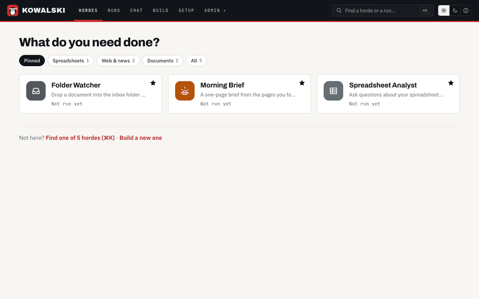

<!-- post: date=2026-10-25; slug=kowalski-2-6; summary=Kowalski 2.6 Field Notes: research notes saved straight into your Obsidian vault, web search with no key, and a Morning brief that only reports what is really on the page. -->
# Kowalski 2.6: Field Notes

*October 2026*


Yesterday's release was about getting kowalski onto your machine. Today's is about what it brings
back: notes that land where you keep your notes, search that works the moment you install it, and
a brief you can trust.

## Notes in your vault

Point kowalski at your Obsidian vault once, in Setup. From then on, hordes that write notes save
them straight into the vault's **Kowalski** folder, named by date and title, with front matter
that Obsidian shows as properties: where the note came from, which horde wrote it, and its tags.
A note is never overwritten. There's no plugin: a vault is a folder of Markdown, so writing a file
is the whole integration.

The **Knowledge Compiler** is the first to use it, and it got a proper form: **what should the note
answer**, and **which pages to read**. It reads them, answers your question from what they say,
and files the note. The **Morning brief** files its daily brief in the vault, too.

## Search out of the box

Agents could always read a page you gave them. Now they can search without any setup:
**DuckDuckGo** is the default, no key needed. For steadier search, Setup offers Brave, Staan,
**Tavily**, **Google via Serper** and **Google Programmable Search**, each with its free
allowance shown, or SearXNG on your own server. A provider set up without its key falls back to
DuckDuckGo instead of switching search off.

## A brief that only says what's there

We caught the Morning brief inventing GitHub repositories. The model wasn't at fault so much as
starved: GitHub's trending page is 650 KB, the list starts after 450 KB of menus, and kowalski
used to cut pages before cleaning them up. Now it reads the whole page and cleans it first. News
feeds (RSS and Atom) come in as clean lists of stories; the brief follows new AI papers through
arXiv's feed, as arXiv asks automated readers to; and a site that says "slow down" gets one
polite retry. We checked every item in the brief against the page it came from.



## Also in 2.6

- Kowalski reads RSS and Atom feeds wherever it fetches a page, not only in the brief.
- A request you type with words of its own names its run, instead of the horde's default question.
- The four crates are on crates.io as 2.6.0.

The full list is in the [changelog](https://github.com/yarenty/kowalski/blob/main/CHANGELOG.md).
Over the next two weekends we'll look closer at the Morning brief and the Knowledge Compiler.

## Get it

On a Mac, [Kowalski.dmg](https://github.com/yarenty/kowalski/releases/latest/download/Kowalski.dmg).
On a Mac or Linux, from a terminal:

```bash
curl -fsSL https://raw.githubusercontent.com/yarenty/kowalski/main/install.sh | bash
kowalski
```
